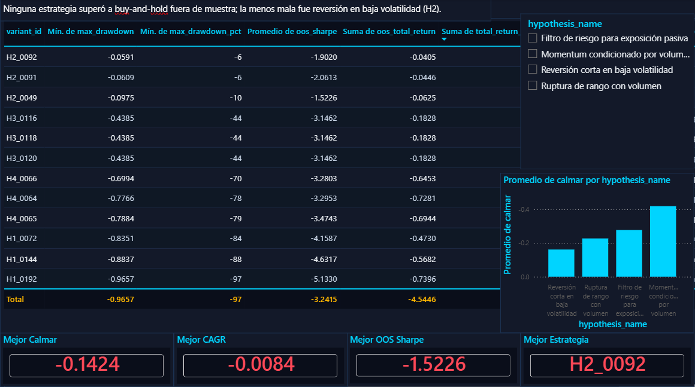

# Pipeline de datos de criptomonedas sobre Binance


License: MIT

Armé este proyecto para descargar velas OHLCV históricas desde Binance, guardarlas limpias en PostgreSQL y mostrar los resultados de dos estrategias cuantitativas en un tablero ejecutivo de Power BI.

El proyecto nació como una duda honesta: ¿se puede sacar alguna ventaja estadística real de operar BTCUSDT según el día de la semana, o es puro azar? Para contestarla hice backtesting sobre 4 activos (BTC, ETH, BNB y SOL) con los últimos 13 meses como datos fuera de muestra, y después corrí una validación Monte Carlo con 5000 permutaciones aleatorias de mismo nivel de exposición para separar la señal del ruido.

---

## Dashboard (Power BI)



## Lo que encontré

Experimento aparte: [protocolo H2 reversión a la media con walk-forward causal tipo Bull](docs/h2_bull_protocol.md). Está separado de las estrategias de calendario que vienen abajo. La evaluación de 24/3 meses elige H2 dentro de cada ventana de entrenamiento y protege los datos de junio de 2026 en adelante. Esa parte está probada con datos sintéticos y todavía no tengo una medición histórica real.

Backtesting de dos estrategias basadas en calendario sobre 4 activos (BTCUSDT, ETHUSDT, BNBUSDT, SOLUSDT), últimos 13 meses como datos fuera de muestra:

| Estrategia | Activo | Retorno | Sharpe | Max DD | Gana a BH |
|---|---|---|---|---|---|
| **H4 — Evitar jueves** | BNBUSDT | +26.0% | 0.72 | -45.3% | 69.2% |
| **H4 — Evitar jueves** | ETHUSDT | +21.2% | 0.62 | -38.7% | 84.6% |
| **H2 — Miércoles largo** | ETHUSDT | +13.9% | 0.66 | -20.5% | 61.5% |
| **H4 — Evitar jueves** | SOLUSDT | -15.8% | 0.05 | -56.7% | 69.2% |

**Validación estadística (Monte Carlo, N=5000 permutaciones):**
- H2 miércoles largo quedó en el **percentil 85.9%** sobre permutaciones aleatorias de misma exposición.
- H4 evitar jueves llegó al **percentil 99.3%** y fue la número 1 de los 7 días de la semana en los 4 activos.

Los resultados son solo informativos y no son recomendaciones de inversión.

---

## Arquitectura

```
Binance API
    │
    ▼
┌─────────────────────────────────────────────────────┐
│  INGESTA  (src/ingestion.py)                        │
│  Lee los ZIP / Parquet mensuales de OHLCV           │
└──────────────────────┬──────────────────────────────┘
                       │
                       ▼
┌─────────────────────────────────────────────────────┐
│  VALIDACIÓN  (src/validation.py)                    │
│  NULLs, integridad OHLC, marcas de hueco y outlier  │
└──────────────────────┬──────────────────────────────┘
                       │
                       ▼
┌─────────────────────────────────────────────────────┐
│  TRANSFORMACIÓN  (src/transform.py)                 │
│  Retornos open-to-open, SMA, volatilidad, régimen   │
└──────────────────────┬──────────────────────────────┘
                       │
                       ▼
┌─────────────────────────────────────────────────────┐
│  CARGA  (src/database.py)                           │
│  Escribe en PostgreSQL con psycopg2 + pd.to_sql()   │
└──────────────────────┬──────────────────────────────┘
                       │
                       ▼
             ┌──────────────────┐
             │   PostgreSQL 15  │
             └────────┬─────────┘
                      │
                      ▼
             ┌──────────────────┐
             │  Power BI        │
             │  Tablero         │
             └──────────────────┘
```

---

## Stack técnico

| Capa | Herramienta | Para qué |
|---|---|---|
| Fuente de datos | Binance Vision API | Velas OHLCV históricas |
| Almacén crudo | Apache Parquet | Formato columnar, 10 veces más chico que CSV |
| Procesamiento | Python 3.10, Pandas, NumPy | ETL e ingeniería de variables |
| Base de datos | PostgreSQL 15 | Almacenamiento estructurado y consultas KPI |
| Visualización | Power BI | Tablero ejecutivo |
| Investigación | Jupyter Notebooks | EDA y exploración de estrategias |
| Control de versiones | Git | Historial del proyecto |

---

## Estructura del proyecto

```
binance-crypto-pipeline/
│
├── data/               # Salidas del pipeline (en .gitignore)
│   ├── raw/
│   ├── processed/
│   ├── exports/        # CSV para Power BI
│   └── reports/
│
├── notebooks/
│   ├── quant_eda.ipynb
│   └── experiments.ipynb
│
├── src/                # Pipeline de producción
│   ├── ingestion.py
│   ├── validation.py
│   ├── transform.py
│   ├── database.py
│   ├── config.py
│   └── utils.py
│
├── research/           # Scripts de investigación cuantitativa
│   ├── quant_eda.py
│   ├── q3_backtesting_framework.py
│   ├── q4_quant_research_lab.py
│   ├── q5_pattern_discovery.py
│   ├── q6_backtest_engine.py       ← motor open-to-open
│   ├── s2_hypothesis_strategy_lab.py
│   ├── s3_overfit_audit.py
│   ├── s4_institutional_validation.py
│   └── exposure_benchmark.py       ← benchmark Monte Carlo
│
├── sql/
│   ├── create_tables.sql
│   ├── views.sql
│   └── queries.sql
│
├── dashboard/
│   ├── powerbi/
│   └── screenshots/
│
├── docs/
│   ├── methodology.md
│   ├── architecture.md
│   ├── findings.md
│   └── roadmap.md
│
├── tests/
│   └── test_pipeline.py
│
├── main.py
├── .env.example
├── requirements.txt
└── .gitignore
```

---

## Cómo levantarlo

```bash
# 1. Clonar e instalar
git clone https://github.com/OrlandoCorona/binance-crypto-pipeline.git
cd binance-crypto-pipeline
pip install -r requirements.txt

# 2. Configurar el entorno
cp .env.example .env
# Editar .env con las credenciales de PostgreSQL

# 3. Crear la base y las tablas
psql -U postgres -c "CREATE DATABASE crypto_pipeline;"
psql -U postgres -d crypto_pipeline -f sql/create_tables.sql
psql -U postgres -d crypto_pipeline -f sql/views.sql

# 4. Correr el pipeline
python main.py

# 5. Correr las pruebas
pytest tests/ -v
```

---

## Metodología de la investigación

Todas las estrategias usan **retorno open-to-open** para que no haya lookahead:

```
señal[t]  →  posición = señal.shift(1)  →  retorno = open[t+1] / open[t] - 1
```

La señal que se genera en la barra `t` se ejecuta al open de la barra `t+1`. Las estrategias se validaron contra un **benchmark Monte Carlo de igual exposición** con 5000 permutaciones, para confirmar que los resultados superan al azar manteniendo la misma duración expuesta.

Metodología completa: [docs/methodology.md](docs/methodology.md) · Resultados completos: [docs/findings.md](docs/findings.md)

---

## Licencia

MIT — ver [LICENSE](LICENSE)
